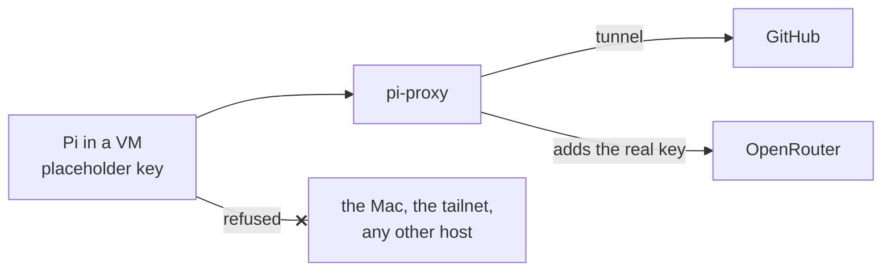

# tan-toolchains

Run [Pi](https://pi.dev) coding agents in Apple
[`container`](https://github.com/apple/container) VMs on your Mac. Each VM can
reach only `pi-proxy`, which tunnels GitHub and adds your OpenRouter key to
model calls. The key never enters the VM, and Pi cannot reach your Mac, your
tailnet or the rest of the internet.

You can also start sessions from your phone over Tailscale
([fleet](fleet/README.md)), or run offline against a model on the Mac
([playbook 3](docs/playbooks.md#3-offline-with-a-local-model)).



## Quickstart

You need an Apple silicon Mac on macOS 26 with the Command Line Tools and
Apple `container` installed ([Setup](docs/playbooks.md#set-up-once)), and an
OpenRouter key.

```sh
T=~/src/tan-toolchains     # your checkout
git clone https://github.com/TanGentleman/tan-toolchains $T
container system start
mkdir -p ~/.pic/config && printf 'OPENROUTER_API_KEY=\n' > ~/.pic/config/env
chmod 600 ~/.pic/config/env && open -e ~/.pic/config/env    # paste the key
cd $T/pi-container && ./build.sh full
./run.sh check                                               # no FAIL lines
cd ~/code/your-repo && $T/pi-container/run.sh                # Pi on this folder
```

Pi edits the current folder on your Mac, so use it only on repos you trust;
`run.sh --clone you/your-repo` works on a clone in a volume instead. Add
`GITHUB_TOKEN` to the env file for private repos and pushes
([token scope](pi-container/docs/configuration.md#host-env-file)).

## Before you rely on it

- [Network boundary](docs/network-boundary.md): what each egress profile
  allows, how the lock works, and its limit (it trusts the VM's kernel).
- `--manual` and `--allow-egress` are not locked and reach any host;
  `--allow-egress` puts the real key in the VM
  ([manual mode](pi-container/docs/manual.md), [egress mode](pi-container/docs/egress.md)).
- [pi-container limits](pi-container/README.md#limits) and the
  [fleet security model](fleet/README.md#security-model): the GitHub token
  is in the VM, and what mounts and fleet owners can do.

## Docs

- [Playbooks](docs/playbooks.md): setup, Pi on a repo, chats from your phone,
  offline with a local model, and upgrading `container`.
- [pi-container](pi-container/README.md): the reference for `run.sh`, with its
  own docs index.
- [fleet](fleet/README.md) and [fleet on macOS](fleet/docs/macos.md): sessions
  from your phone, and the setup with a check per step.
- [enforcer](enforcer/README.md) (a Pi prompt hook, in every image but `min`)
  and [zigpeek](zigpeek/README.md) (Zig docs for Pi, in the `zig` image).
- Working on the repo: [AGENTS.md](AGENTS.md).
